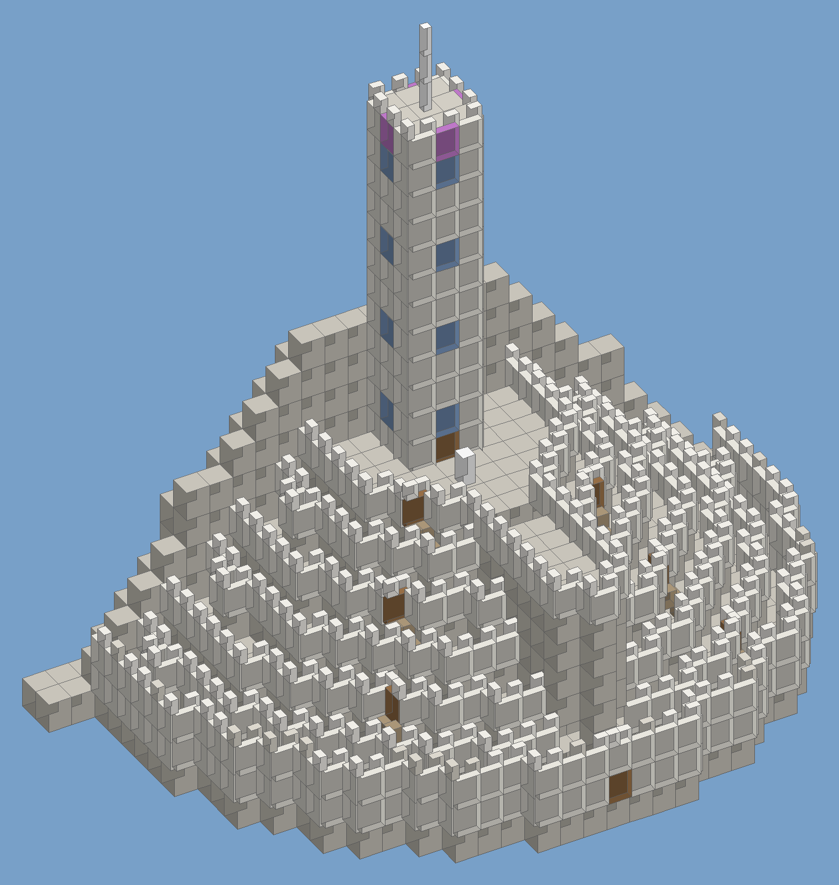

# RuneScape: Dragonwilds: Minas Tirith



Minas Tirith, the White City of Gondor, built from Dragonwilds' own **Castle** building pieces. It comes as
a blueprint for the **WildPlans** mod, which places a whole building in one go.

**What's in the city**
- **Seven tiers.** Each is a stone terrace, battlemented, and 3 m higher than the one below. The first
  (outer) wall is two courses high, with arrow slits.
- **Seven gates and the road between them.** The Great Gate faces east. The gates above it alternate
  between south-east and north-east, as in the books, with stairs up to each.
- **The prow.** This is the great spur of rock that runs east from the Citadel and splits the city. It has
  a tunnel on each tier, so the road can zig-zag up through it.
- **The Citadel.** It holds the White Tower: 12 storeys, with windows, stained glass at the top,
  battlements and a spire. A white tree stands in the court in front of the tower door.
- **Mount Mindolluin.** A stone ridge behind the city, as if the city were built against it.

**Size and piece counts**
- `MinasTirith.wplan` (default): 2,615 pieces, about 93 m wide and 55 m front to back. It's about 64 m
  to the tip of the spire.
- `MinasTirith_small.wplan`: 1,977 pieces, for a first try.

**Status: not yet tested in game.**
- The pieces, sizes and file format come from WildPlans' own data, and offline tests check the plan:
  - nothing is doubled;
  - every foundation connects to the ground;
  - a walk from the Great Gate reaches the Citadel.
- Things that could still need adjusting are listed in [Troubleshooting](#troubleshooting).

## What you need

| | |
|---|---|
| The game | RuneScape: Dragonwilds on PC (Steam). Mods don't work on consoles. |
| UE4SS for Dragonwilds | The script loader every Dragonwilds Lua mod uses: [Nexus Mods, "UE4SS for RSDragonwilds"](https://www.nexusmods.com/runescapedragonwilds/mods/4). |
| WildPlans | The blueprint mod that places the city: [github.com/kaedon78/WildPlans](https://github.com/kaedon78/WildPlans/releases) (free, MIT). This blueprint was made for v0.1.4. |
| Architect (strongly recommended) | Removes the stability limits and raises the build height limit: search "Architect" on [Nexus Mods for Dragonwilds](https://www.nexusmods.com/runescapedragonwilds). Without it, the White Tower and the upper tiers are likely to be refused as "unstable". |
| A Creative world | Building is free there, and WildPlans can place real pieces instead of ghosts. |

## Step by step

### 1. Back up your saves
1. Press **Win + R**, paste `%LOCALAPPDATA%\RSDragonwilds\Saved\SaveGames` and press Enter.
2. Copy that whole folder somewhere safe, for example to your Desktop.

If you use this repo's CLI, `um backup` does the same thing.

### 2. Install UE4SS
1. Download UE4SS from the Nexus page above. If it offers several builds, the Dragonwilds mod authors
   currently recommend the **"UE4SS Steam (latest)"** file.
2. In Steam, right-click RuneScape: Dragonwilds and choose **Manage > Browse local files**.
3. Open `RSDragonwilds\Binaries\Win64`.
4. Extract the zip there, so that `dwmapi.dll` and the `ue4ss` folder sit next to
   `RSDragonwilds-Win64-Shipping.exe`.
5. Start the game once and quit. Then open `Win64\ue4ss\UE4SS.log`:
   - If it ends without a "Fatal Error", UE4SS works.
   - If it says "Fatal Error", you have an old build. Get the latest one from the Nexus page.

### 3. Install WildPlans
1. Download `WildPlans-v0.1.4.zip` (or newer) from the
   [WildPlans releases page](https://github.com/kaedon78/WildPlans/releases).
2. Unzip it into `Win64\ue4ss\Mods\`, so that you get `Mods\WildPlans\Scripts\main.lua`.
3. Open `Mods\mods.txt` in Notepad and add the line `WildPlans : 1`. Put it above the `Keybinds` line if
   there is one, otherwise at the end. Don't rely on WildPlans' own `enabled.txt`: on one install,
   UE4SS didn't start WildPlans until it was listed in `mods.txt`.
4. Start the game. When WildPlans has loaded, a small gold house icon with an **N** under it appears at
   the bottom right of the HUD.

### 4. Install Architect (recommended)
1. Follow its Nexus page. It's another UE4SS mod, so its folder goes into `Win64\ue4ss\Mods\`.
2. Add `Architect : 1` to `mods.txt`.
3. Check that it works on your game version: after a game start, search `UE4SS.log` for `Architect`.
   - If the log is full of `Tried setting member variable 'MinStability' but UObject instance is
     nullptr`, or shows an error in `Architect\Scripts\main.lua`, it doesn't work on your game version
     yet. That was the case on 2026-10-23.
   - In that case set `Architect : 0` and wait for an update. The city still places without it; only the
     tallest parts may be refused as unstable.

### 5. Copy the blueprint in
1. Press **Win + R**, paste `%LOCALAPPDATA%\RSDragonwilds\Saved` and press Enter.
   - This folder is on your C: drive, under your Windows user. It is *not* in the game's install folder.
2. Open `WildPlans`, then `blueprints`.
   - WildPlans is meant to create these folders the first time it runs, but on one install it didn't.
   - If either folder is missing, create it yourself with right-click > **New > Folder**.
   - The `blueprints in ...` line in `ue4ss\UE4SS.log` shows the exact path WildPlans uses.
3. Copy `MinasTirith.wplan` into that folder. Add `MinasTirith_small.wplan` too if you want the small
   one.
4. Check the files end in `.wplan`, not `.wplan.txt` (in Explorer, turn on **View > Show > File name
   extensions**). Then press **N** twice in game; the panel should list them.

Download the files from this folder of the repo: open the file on GitHub, then use **Download raw file**.

### 6. Make a world and find a spot
1. Create a new world and choose **Creative**. Building costs nothing there.
2. Find open, flat ground about **100 m wide and 60 m deep**. Each 3 m foundation can only make up a few
   metres of slope, so the flatter the better. A large meadow or beach works well.

### 7. Place the city
1. Stand roughly where the middle of the city should go.
2. Press **N** to open the blueprints panel, click **MinasTirith**, then click **REPLAY** > **PLACE**.
3. The whole city appears as one ghost in front of you, and the camera pulls back so you can see it.
4. Position the ghost:
   - **Mouse wheel** turns it 15 degrees at a time. **Shift + wheel** turns it 1 degree.
   - **Alt + wheel** moves it forward and back. **Ctrl + wheel** moves it up and down.
   - Turn it so the Great Gate faces where you want the city to look out. The mountain is at the back.
5. When the ghost shows green, press **O** to place it as real pieces. This only works in a Creative world.
   In a normal world, press **N** to place free ghost pieces instead, and build them from the build menu
   with materials (the panel's **DETAILS** button lists everything it takes).
6. Wait while it builds. The progress shows on the right of the screen ("Placing - 540 / 2615").
   - It takes roughly **15 to 20 minutes** for the full city.
   - Stay near the middle and don't fly off. Pieces sent from more than about 175 m away don't arrive.
   - WildPlans retries any pieces the game refused, in up to five passes.

To take it down again, open the panel and go to **PLACEMENTS > REMOVE**. That removes only the pieces this
placement put there, and it asks first.

Don't use **REPLAY > IN PLACE** with this blueprint. It was generated rather than captured, so "in place"
means the map's origin point.

## Troubleshooting

| What you see | What to do |
|---|---|
| The ghost stays red | Some ground foundations would float or be buried. Find flatter ground, or raise or lower the ghost with **Ctrl + wheel**. |
| The tower or upper tiers are missing, or say "unstable" | Install Architect (step 4) and place it again. Without it, the game's stability rules limit how high you can stack. |
| The stairs at the gates face the wall | Make a fresh blueprint with the stairs turned round: `python make_minas_tirith.py --stairs-flip`. Remove the old placement and place the new one. |
| The stairs float or sink a little | Adjust their height: `--stair-z 50` or `--stair-z 100` (the default is 75 cm). |
| The game stutters or a few pieces don't land | Try `MinasTirith_small.wplan` first. WildPlans has been tested with placements of up to about 1,150 pieces. To slow it down, put a `pacing.txt` in the blueprints folder with the lines `step_ms_local 500` and `batch_pause_ms 4000`. |
| The panel says the blueprint has pieces the game doesn't have | A game update renamed pieces. Update WildPlans and check this repo for a newer blueprint. |
| No gold N icon, and nothing happens on N | WildPlans isn't loaded. Make sure `WildPlans : 1` is in `Mods\mods.txt`, and that `Mods\WildPlans\Scripts\main.lua` exists (not a doubled `WildPlans\WildPlans` folder). Then check `Win64\ue4ss\UE4SS.log` for `[WildPlans]` lines. |
| The panel says BLUEPRINTS (0) | The `.wplan` files aren't in the folder WildPlans reads. Search `UE4SS.log` for `blueprints in` to see the exact path, and check the files don't end in `.txt`. |

## Making your own version

The blueprint comes from `make_minas_tirith.py`. It needs Python 3.10 or newer, plus Pillow if you want
the preview images. Any of these writes a new `.wplan` next to the script:

```
python make_minas_tirith.py                       # the default (medium) city
python make_minas_tirith.py --size small          # or large: 4,074 pieces, an 18 m citadel and a 16-storey tower
python make_minas_tirith.py --style kharidian     # pale sandstone from the Umbral Sands set instead of grey castle stone
python make_minas_tirith.py --tower 20            # a taller White Tower (3 m per storey)
python make_minas_tirith.py --no-mountain         # no ridge behind the city
python make_minas_tirith.py --name MyCity         # writes MyCity.wplan
```

Run `python make_minas_tirith.py --help` for every option.

**How it works**
- The city is laid out on the game's building grid, using 3 m foundations.
- A tier's terrace is a stack of foundations, one for each tier below it.
- Walls sit on the edges where the ground steps down. Gates, stairs, the prow's tunnels and the tower
  are placed on that same grid.
- Every piece is written as a line WildPlans understands:
  `piece <index> <x> <y> <z> <yaw> 1 1 1 ghost`, in centimetres.
- The file also records each piece's asset path, so WildPlans can still find the right piece if a game
  update renumbers them.

## Fair play and sharing
- **Your world:** fine. Jagex's
  [Community Modding Guidelines](https://legal.jagex.com/docs/policies/runescape-dragonwilds-community-modding-guidelines)
  allow mods like this for your own play.
- **Someone else's server:** only with the host's OK.
- **Selling:** never. Paid mods are not allowed.
- **Tolkien:** Minas Tirith belongs to the Tolkien estate. Keep this a free fan build for yourself and
  your friends.

## Credits
- **WildPlans** by kaedon78 (MIT) does everything in game. This folder only writes a blueprint file for
  it. The piece numbers, sizes and asset paths in `make_minas_tirith.py` come from WildPlans' data
  tables.
- **UE4SS** by the UE4SS team; the Dragonwilds build is from its Nexus page.
- RuneScape: Dragonwilds is © Jagex. This is an unofficial fan project, not endorsed by or affiliated
  with Jagex. Nothing in this folder comes from the game's files.
- No fal-generated assets: the preview is drawn by the script itself.
